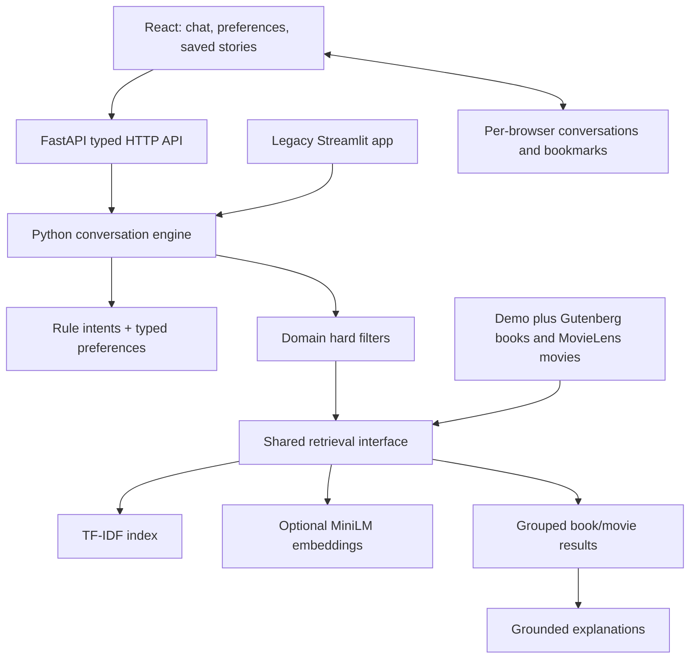

# Architecture

Shared components handle conversation state, intent/media detection, preferences, preprocessing, title matching, filtering, retrieval, and explanations. Domain-specific fields stay separate: pages for books and runtime for movies. Cross-media search uses the same text embedding model for both catalogs and a reference context containing description, genres, and themes. It indicates similarity, never an adaptation relationship.

Request flow: parse message → inherit or update state and controls → resolve reference → apply hard filters → rank eligible records (or transparently sort filter-only matches when query text has no catalog signal) → explain evidence → group results by media. Source CSVs are normalized locally. TF-IDF matrices and embeddings are cached using content, model, and configuration hashes so changed catalogs or preprocessing rebuild the affected artifacts.

The React interface sends a message and validated conversation state to
`POST /api/chat`. Pydantic transport models become the same Python dataclasses
used by Streamlit. Each request has its own conversation state; there is no
global visitor conversation. Bookmarks and recent conversations persist per
browser in localStorage. `POST /api/recommend` applies edited preferences
directly, without reparsing a previous query and reintroducing an old numeric
limit. Both routes use `StoryScoutEngine.recommend` for ranking and explanations.
Ambiguous titles expose a choice of catalog IDs. Selected references are retained
for follow-up media switching and excluded from same-medium results.

FastAPI serves `frontend/dist` and public assets on the same origin as `/api`.
In development Vite proxies API requests. Model loading runs during lifespan
preparation, with health/readiness routes and honest fallback reporting. One
worker holds the shared model and indexes; a lock bounds concurrent CPU work.

The current retrieval document includes local original plot text when available.
Source text flows through TF-IDF and chunk-pooled MiniLM; the separate local
plot-genre classifier and mood/theme prototypes supply soft ranking signals.
Hard-filtered candidates pass through preference reranking and MMR selection.
Conversation state now includes a retained content query and served item IDs,
which support topic-preserving refinements and nonrepeating next picks. Full plot
text stays on the Python server; the browser receives opening excerpts, source
provenance, keywords, and ranking components.

The free hosted profile uses the same pretrained MiniLM architecture via its
official quantized ONNX export, with the original tokenizer, 256-token cap,
masked mean pooling and L2 normalization. It does not import PyTorch. Both
media share 384-dimensional vectors, while TF-IDF, preference merging, hard
filters, mood/theme signals, classifier predictions and MMR remain local Python.
The compact source subset contains 1,000 books and 1,500 movies. Its model cache
keys include the ONNX backend to prevent mixing quantized and original vectors.
The full local profile continues to use Sentence Transformers when configured.

## Current relevance and state policy

Title lookup remains separate from content retrieval. Topic and preference
queries are scored separately; a small additional sparse title/entity field
shares the TF-IDF vocabulary. Topic gates precede bounded preference boosts,
quality cutoffs, and MMR. Factual-filter-only browsing reports zero text similarity.
The API accepts explicit new/follow-up/similarity actions. Visible topic and
reference chips are authoritative, so removing them cannot reparse stale UI text.
See [policy and executed results](NLP_RELEVANCE_UPDATE.md).

## Passage matching update

Overlapping narrative passages now supplement whole-document retrieval, with one
card per title and source-grounded passage evidence. See [implementation, actual
ablation results, caching, and validation](PASSAGE_MATCHING.md).
