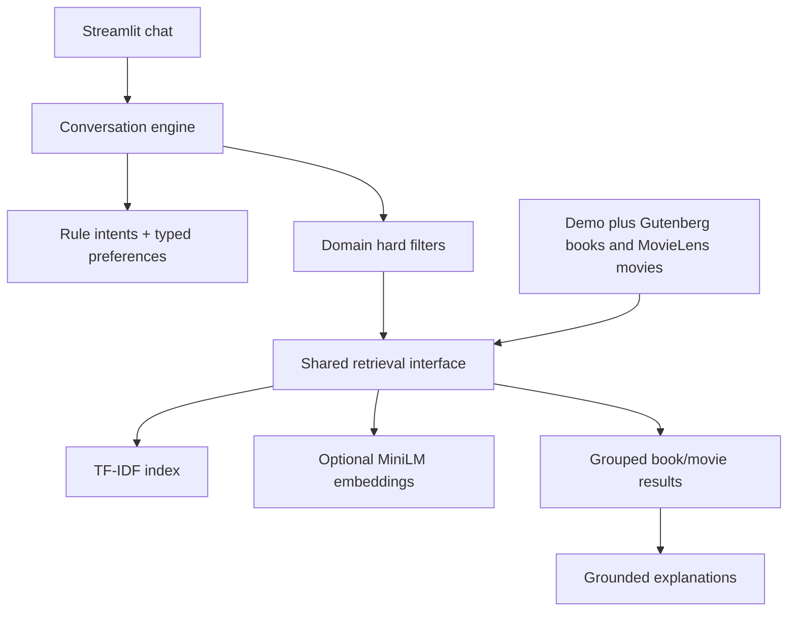

# Architecture

Shared components handle conversation state, intent/media detection, preferences, preprocessing, title matching, filtering, retrieval, and explanations. Domain-specific fields stay separate: pages for books and runtime for movies. Cross-media search uses the same text embedding model for both catalogs and a reference context containing description, genres, and themes. It indicates similarity, never an adaptation relationship.

Request flow: parse message → inherit or update state and controls → resolve reference → apply hard filters → rank eligible records (or transparently sort filter-only matches when query text has no catalog signal) → explain evidence → group results by media. Source CSVs are normalized locally. TF-IDF matrices and embeddings are cached using content, model, and configuration hashes so changed catalogs or preprocessing rebuild the affected artifacts.
